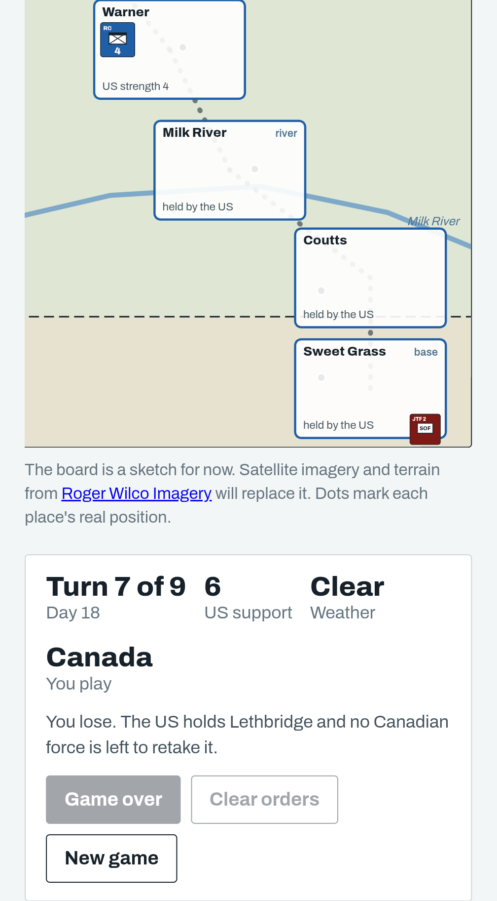

# Case 2: JTF 2 sits in Sweet Grass for twelve days

[Force on Force](https://forceonforce.si) war journal · 19 November 2026 · **Open**

The rules gave this game to the United States, and nobody disputes that. The case is about what the rules could
not see: a special-operations detachment that spent twelve days on American soil while the battle was lost to
its north.

## What happened

[Kevin Duska](https://kevinduska.com) played Canada in the [border-battle prototype](https://forceonforce.si/play/)
on 19 November 2026, with the JTF 2 variant switched on in one of its non-fighting versions. He put his effort
into holding Stirling and Magrath, the two places south of Lethbridge. On turn 7, day 18, the US held
Lethbridge and no Canadian force was left to retake it. The game ended there.

JTF 2 had gone south on turn 3, day 6, and was in Sweet Grass, Montana, the US base at the Interstate 15
crossing. It was still there when the game ended, twelve days later. US support stood at 6, untouched.

*The south of the board at the end, from Kevin's phone. The dark red counter in Sweet Grass is JTF 2.*

## What the rules did with it

Nothing, for three reasons.

- **Nobody could find it.** The US rolls to detect JTF 2 only when US units share its area. Sweet Grass was
  empty. This is the gap Case 1 found: no US force ever comes up from Montana.
- **It had no effect there.** In these versions JTF 2 tips fights over an area the US occupies and cannot hold
  ground. In an empty base it does neither, and the base stayed "held by the US" with JTF 2 inside it.
- **It did not count at the end.** The game ends when no Canadian force is left that could retake Lethbridge,
  and JTF 2 is not that kind of force.

Kevin's view is that the rules are right as far as they go. The question is what would have happened.

## The question

A special-operations detachment has twelve days behind the enemy's line, at the mouth of one of his two supply
roads. What does it do with them, and how does the American public react?

## What is known and assumed going in

- **How many.** JTF 2's strength is not public. Kevin's working figure is about 40, if a single sub-unit
  deploys.
- **What it has.** A finite load and no resupply. Kevin's point: it is sitting beside the enemy's supply road,
  and could take what it needs from it.
- **Three kinds of job.** Watch and report. Disrupt the supply moving through the crossing. Guide something
  bigger, which in this scenario Canada mostly does not have.
- **The trade.** Watching can go on for days. The first act of disruption tells the other side someone is
  there and starts the hunt.

## How it could reach the American public

Kevin set out the branches on 19 November. They are not exclusive.

| Branch | What Americans see | The line it produces |
|---|---|---|
| Found, having done little | A news story and a wave of memes | "Canadian special forces were in Montana." |
| Not found, and acting | Effects with no visible cause | "We captured Lethbridge. So why is northern Montana blowing up, and why are our people being shot at long range?" |
| Not found, only watching | Nothing | No line at all. The effect is on the battlefield only |
| With armed local groups | Irregulars appearing beside the detachment | See below |

**Who is being hurt decides most of this.** Case 1's press test found one thing that every simulated outlet
agreed on: harm to American civilians turns a small, short rally into a large and lasting one. Soldiers and
supplies on a military road are one story. The 65 people who live in Sweet Grass are another. Any rule that
comes out of this case has to keep the two apart.

**The fourth branch depends on people this game does not yet have.** Kevin's picture of it, as American
television might show it: "self-mobilized Indigenous units with hunting rifles led by white guys with beards".
That picture assumes an alignment nobody has asked for. The ground on both sides of this crossing is Blackfoot
territory. The Blackfeet in Montana are American citizens. The three Blackfoot nations in Alberta are in treaty
with the Crown. All four are one confederacy, and they could as easily press both armies to leave, or stay out,
as take a side. Neither the game nor the model has them as actors, Case 1 already said no ruling should assume
which way they go, and Kevin has said he wants to talk to people before the model assumes anything. So this
branch is recorded as a question. It is not a rule and it is not a forecast.

## Two blind estimates

We have asked two AI agents, working alone and told nothing of this write-up, what such a detachment could
realistically do in twelve days. One reasons from historical cases of small teams behind an enemy's line. The
other reasons from what a team can carry, how long it lasts and how an army guards its rear. Both were asked
how far taking American supplies would stretch the stay and what that costs in risk of being found. Both are
held to effects by category: no techniques and no targets.

Their estimates will be added here when they are in.

## What the game would need

- **A choice each turn behind the line.** Watch: a low chance of being found and a small effect. Act: the US
  force supplied through that crossing is held up or fights worse for a turn, the chance of being found jumps,
  and the public reaction starts.
- **A US force that can come looking.** Without one, a base behind the army is the safest place on the board.
  Case 1 needs the same thing.
- **A place for the public reaction.** The branches above belong to the narrative module the model does not
  have yet, with the memes from Case 1.
- **A rule for the end.** If the battle is lost with the detachment still behind the line, does anything
  follow from it?

## Status

Opened on 19 November 2026. No ruling is proposed yet. The estimates come first, then a question for the
[discussion board](https://github.com/Prime-Rogue-Inc-Corporate/force-on-force-war-journal-and-discussions/discussions).
